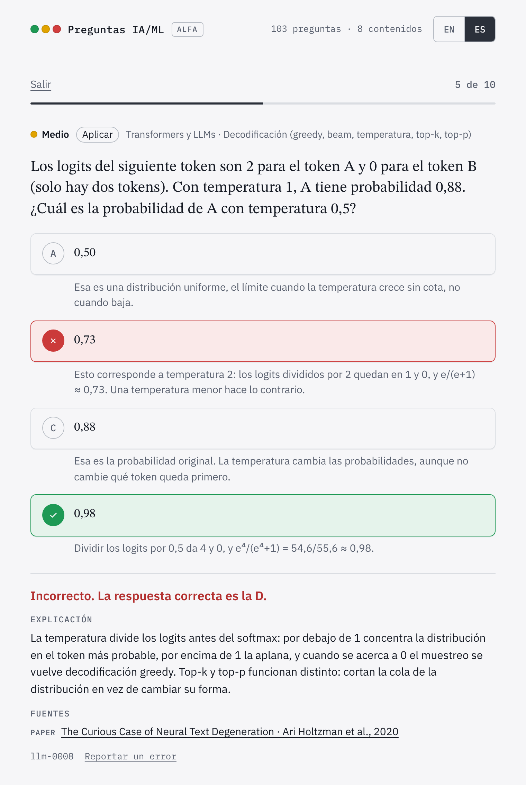

# Preguntas IA/ML

[English](README.md) · **Español**

Preguntas de opción múltiple gratuitas para aprender inteligencia artificial y machine learning, de lo básico a temas de investigación. Cada alternativa explica por qué es correcta o incorrecta, y cada pregunta cita sus fuentes.

**Pruébalo: https://ai-ml-questions.strangemachines.workers.dev/#es**

<picture>
  <source media="(prefers-color-scheme: dark)" srcset="docs/images/question-es-dark.png">
  
</picture>

- **103 preguntas en inglés y en español**, en 8 contenidos y tres niveles. El modo estudio muestra la explicación después de cada respuesta; el modo examen, el resultado al final.
- **La respuesta no se nota en la redacción.** Las preguntas siguen las reglas de redacción de Haladyna, y un validador las revisa: por ejemplo, avisa cuando la alternativa correcta es bastante más larga que las demás.
- **Medidas con respuestas reales.** Las respuestas se registran de forma anónima y sin cookies; cuando una pregunta reúne suficientes, muestran su dificultad real y qué distractores no engañan a nadie ([detalle](docs/statistics.md), en inglés).
- **Preguntas abiertas.** Son archivos JSON con un esquema, bajo CC BY-SA 4.0, así que puedes reutilizarlas en un curso, en tarjetas de estudio o en tu propia app.
- **Sin cuenta.** Una vez cargado funciona sin conexión, y se puede instalar en el teléfono.

**Versión alfa.** Las preguntas son borradores que todavía no revisa una persona. Si encuentras un error, usa el enlace «Reportar un error» bajo la pregunta o [abre un issue](https://github.com/CristobalSantana/ai-ml-questions/issues).

## Contenidos

| Contenido | Por ejemplo |
|---|---|
| Machine learning tradicional | Sesgo y varianza, gradient boosting, procesos gaussianos, dataset shift, Q-learning |
| Redes neuronales | Backpropagation, optimizadores, LSTM, mixture of experts, PINN, KAN |
| Transformers y LLMs | Atención, la ventana de contexto y la KV cache, prompting, LoRA, RLHF |
| Retrieval y RAG | BM25, embeddings, HNSW, chunking, reranking, evaluación de RAG |
| Visión por computador | Convolución, detección, segmentación, ViT, CLIP |
| Agentes, harness y fenómenos | Uso de herramientas, MCP, prompt injection, double descent, grokking, sycophancy |
| Evaluación e IA responsable | Precision y recall, calibración, LLM como juez, equidad, privacidad |
| Papers clave | Del perceptrón (1958) a FlashAttention (2022) |

## Cómo se hacen las preguntas

Cada pregunta declara su nivel en la taxonomía de Bloom, que el sitio muestra como el tipo de razonamiento que pide (de Recordar a Evaluar), y recibe una dificultad estimada con una rúbrica. Un validador revisa el formato y las reglas de redacción, y un segundo modelo revisa los hechos, las fuentes y la traducción antes de que una persona apruebe la pregunta. Cuando una pregunta reúne suficientes respuestas, estas también muestran si distingue a quienes saben más. El detalle está en [`docs/`](docs/README.md), en inglés.

## Cómo aportar

Lo que más sirve ahora es revisar preguntas, porque una persona todavía no las ha revisado todas:

- **Reporta un error** con el enlace bajo cada pregunta, o [abre un issue](https://github.com/CristobalSantana/ai-ml-questions/issues).
- **Revisa las preguntas de un área que conozcas:** la respuesta correcta, las explicaciones y las fuentes.
- **Mejora el español** o **propón preguntas nuevas**.

[CONTRIBUTING.md](CONTRIBUTING.md) explica cómo, en inglés. Puedes escribir los issues y pull requests en español.

## Probarlo en tu computadora

```bash
pip install jsonschema pytest
python scripts/validate.py                    # revisa las preguntas
python -m pytest tests                        # prueba el validador
python scripts/build_site.py --include-drafts # genera site/data
python -m http.server 8000 --directory site   # luego abre http://localhost:8000
```

## Repositorio

| Ruta | Contenido |
|---|---|
| `questions/` | Las preguntas, un archivo JSON por área |
| `taxonomy.json` | Contenidos, áreas y subtemas, en inglés y en español |
| `schema/` | El formato de una pregunta |
| `scripts/` | El validador, el generador del sitio y las estadísticas de cada pregunta |
| `prompts/` | Prompts para generar y revisar preguntas, en inglés y en su versión original en español |
| `site/` | El sitio |
| `worker/`, `migrations/` | El Worker de Cloudflare que guarda las respuestas anónimas, y su tabla |
| `docs/` | La documentación completa, en inglés |

## Licencia

Las preguntas están bajo [CC BY-SA 4.0](LICENSE-QUESTIONS): puedes reutilizarlas si citas la fuente y compartes con la misma licencia. El código está bajo [MIT](LICENSE), y las fuentes tipográficas bajo la SIL Open Font License.

Si el sitio te sirve, una estrella en GitHub ayuda a que más personas lo encuentren. También puedes apoyarlo en [Ko-fi](https://ko-fi.com/strangemachines).
