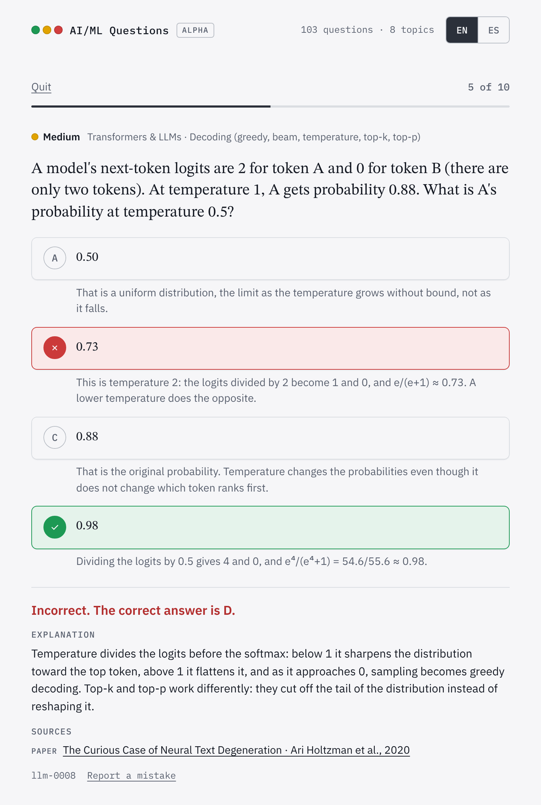

# AI/ML Questions

**English** · [Español](README.es.md)

Free multiple-choice questions for learning artificial intelligence and machine learning, from the basics to research topics. Every option explains why it is right or wrong, and every question cites its sources.

**Try it: https://ai-ml-questions.strangemachines.workers.dev/**

<picture>
  <source media="(prefers-color-scheme: dark)" srcset="docs/images/question-en-dark.png">
  
</picture>

- **103 questions in English and Spanish**, in 8 topics and three levels. Study mode shows the explanation after each answer; exam mode, the results at the end.
- **The answer does not show in the wording.** The questions follow Haladyna's item-writing rules, and a validator checks them: for example, it warns when the correct option is noticeably longer than the others.
- **Measured with real answers.** Answers are recorded anonymously, with no cookies; once a question has enough of them, they show its real difficulty and which distractors nobody falls for ([details](docs/statistics.md)).
- **Open questions.** They are JSON files with a schema, under CC BY-SA 4.0, so you can reuse them in a course, in flashcards or in your own app.
- **No account.** Once loaded it works offline, and it can be installed on a phone.

**Alpha version.** The questions are drafts that a person has not reviewed yet. If you find a mistake, use the "Report a mistake" link under the question or [open an issue](https://github.com/CristobalSantana/ai-ml-questions/issues).

## Topics

| Topic | For example |
|---|---|
| Classical machine learning | Bias and variance, gradient boosting, Gaussian processes, dataset shift, Q-learning |
| Neural networks | Backpropagation, optimizers, LSTMs, mixture of experts, PINNs, KANs |
| Transformers & LLMs | Attention, the context window and KV cache, prompting, LoRA, RLHF |
| Retrieval & RAG | BM25, embeddings, HNSW, chunking, reranking, RAG evaluation |
| Computer vision | Convolution, detection, segmentation, ViT, CLIP |
| Agents, harness & phenomena | Tool use, MCP, prompt injection, double descent, grokking, sycophancy |
| Evaluation & responsible AI | Precision and recall, calibration, LLM-as-judge, fairness, privacy |
| Landmark papers | From the perceptron (1958) to FlashAttention (2022) |

## How the questions are made

Each question states its level in Bloom's taxonomy, which the site shows as the type of reasoning it asks for (from Remember to Evaluate), and gets an estimated difficulty from a rubric. A validator checks the format and the writing rules, and a second model checks facts, sources and the translation before a person approves the question. Once a question has enough answers, they also show whether it tells apart people who know more. The details are in [`docs/`](docs/README.md).

## Contributing

The most useful help right now is checking questions, because a person has not reviewed them all yet:

- **Report a mistake** with the link under each question, or [open an issue](https://github.com/CristobalSantana/ai-ml-questions/issues).
- **Review the questions of an area you know:** the key, the explanations and the sources.
- **Improve the Spanish**, or **propose new questions**.

[CONTRIBUTING.md](CONTRIBUTING.md) explains how. Issues and pull requests can be written in English or Spanish.

## Run it locally

```bash
pip install jsonschema pytest
python scripts/validate.py                    # checks the questions
python -m pytest tests                        # tests the validator, the updates and the waitlist script
python scripts/build_site.py --include-drafts # builds site/data
python -m http.server 8000 --directory site   # then open http://localhost:8000
```

## Repository

| Path | Contents |
|---|---|
| `questions/` | The questions, one JSON file per area |
| `taxonomy.json` | Topics, areas and subtopics, in English and Spanish |
| `updates.json` | The updates listed on the site's home screen |
| `schema/` | The format of a question |
| `scripts/` | The validator, the site builder and the statistics of each question |
| `prompts/` | Prompts for generating and reviewing questions, in English and in their original Spanish |
| `site/` | The website |
| `worker/`, `migrations/`, `migrations-waitlist/` | The Cloudflare Worker that stores the anonymous answers and the waitlist, and their tables |
| `docs/` | The full documentation |

## License

The questions are under [CC BY-SA 4.0](LICENSE-QUESTIONS): you can reuse them if you credit the source and share under the same license. The code is under [MIT](LICENSE), and the fonts under the SIL Open Font License.

If the site helps you, a star on GitHub helps more people find it. You can also support it on [Ko-fi](https://ko-fi.com/strangemachines).
